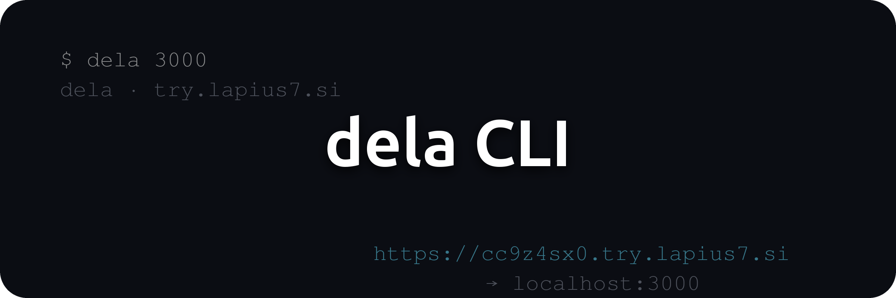

<div align="center">

<p align="center">
  
</p>

<p align="center"><a href="README.md">English</a> | <b>日本語</b></p>

<h1 align="center">dela CLI</h1>

<h3 align="center">ローカルのポートを、一時的な HTTPS の URL で公開する。</h3>

<p align="center"><code>dela 3000</code> を実行すると、<code>localhost:3000</code> が <code>https://app-xxxxxxxxxx.try.lapius7.si</code> から開けます。アカウント登録も SSH 鍵も不要です。</p>

<p align="center">
  <a href="https://github.com/Lapius7/dela-cli/releases"></a>
  <a href="LICENSE"></a>
  <a href="https://go.dev"></a>
  <a href="https://github.com/Lapius7/dela-cli/stargazers"></a>
  <a href="https://github.com/Lapius7/dela-cli/commits/main"></a>
</p>

<p align="center">
  <a href="#概要">概要</a> ·
  <a href="#前提">前提</a> ·
  <a href="#インストール">インストール</a> ·
  <a href="#使い方">使い方</a> ·
  <a href="#トラブルシューティング">トラブルシューティング</a> ·
  <a href="#開発">開発</a>
</p>

</div>

---

## 概要

dela は、`cloudflared tunnel --url` に近い使い方ができるトンネル CLI です。ローカルのポートを、`try.lapius7.si`（sish）のトンネルサーバー経由で公開します。システムの `ssh` コマンドをサブプロセスとして呼び出す薄いラッパーで、SSH プロトコルは自前で実装していません。

詳しい使い方: <https://try.lapius7.si/use>

```
dela 3000
```

```
dela · try.lapius7.si

  ✓ トンネルを確立しました

    https://app-k3x9q2m7ab.try.lapius7.si
        → localhost:3000

  Ctrl+C で終了 · 他のターミナルからは dela list / dela stop で確認・停止できます
```

パネルは色付きで表示されます。`NO_COLOR` 環境変数を設定したときと、標準出力が TTY でないときは無色になります。`Ctrl+C` でトンネルを閉じると、URL は次の起動まで使えなくなります。検索エンジンにインデックスされないよう、サーバーは `noindex` ヘッダーと `robots.txt` を返します。

## 前提

- システムに `ssh`（8.4 以降）があること。Windows 10/11・macOS・Linux には標準で入っています。
- 公開できるのは HTTP(S) のみで、TCP 転送は使えません。サーバーは IP ごとに同時接続数と接続頻度を制限し、1 時間通信がない接続を切ります。
- アカウント登録も SSH 鍵も不要です（誰でも使える公開トンネルです）。初回の実行でサーバーがサブドメインを発行し、dela が `.delaconfig` に保存します。手元の SSH 鍵、`~/.ssh/config`、ssh-agent は使いません。
- サーバーのホスト鍵はバイナリに固定されているため、ホスト鍵の確認プロンプトは出ません。鍵が一致しなければ接続を拒否します。フィンガープリント:
  ```
  SHA256:TFfR22+f3m4Fpp/5u3svHfC95Srtq+OyhWqylM8ioGc
  ```
- 公開するポートでは、先にローカルのサーバーを起動しておきます。dela は転送するだけなので、応答するものがないポートは `502 Bad Gateway` になります。

## インストール

### pnpm（推奨）

このパッケージは pnpm を前提にしています。npm と pnpm の両方に入れると同じコマンドが二重になるため、`pnpm add -g` だけを使ってください。

```bash
pnpm add -g @lapius/dela-cli
```

Linux、macOS（x64・arm64）、Windows（x64）向けのビルド済みバイナリが入ります。Go は不要で、Node.js 18 以降が必要です。更新も同じコマンドで行います。

### インストーラースクリプト（Go でソースからビルド）

Go が入っている環境向けです。

macOS / Linux / Windows（Git Bash・WSL）:

```bash
curl -fsSL https://raw.githubusercontent.com/lapius7/dela-cli/main/install.sh | bash
```

Windows（PowerShell）:

```powershell
irm https://raw.githubusercontent.com/lapius7/dela-cli/main/install.ps1 | iex
```

Windows（コマンドプロンプト）は `irm` / `iex` のワンライナーを実行できないため、ファイルとして保存してから実行します。

```bat
curl -fsSL https://raw.githubusercontent.com/lapius7/dela-cli/main/install.bat -o install.bat && install.bat
```

どのスクリプトも、内部で `go install github.com/lapius7/dela-cli/cmd/dela@latest` を `GOPROXY=direct` で実行します。バイナリは `$(go env GOPATH)/bin`（Windows は `%GOPATH%\bin`）に置かれます。このディレクトリに PATH が通っていなければ、インストーラーが警告を出します。`GOPROXY=direct` にしているのは、Go の公式モジュールプロキシがタグのないブランチの `@latest` の解決結果をキャッシュすることがあり、更新後もしばらく古いコミットが返るためです。更新は同じコマンドをもう一度実行します。

## 使い方

```
dela <port>          例: dela 3000        （localhost:3000 を公開）
dela <host:port>     例: dela 127.0.0.1:8080
dela <port> -v       接続のログも表示する
dela --help
```

### プロジェクトごとの URL

初回の `dela 3000` で、プロジェクトのフォルダ（git リポジトリならそのルート、なければカレントディレクトリ）に `.delaconfig` ができます。サーバーが発行した ID（`app-xxxxxxxxxx.try.lapius7.si` の `xxxxxxxxxx` の部分）と、持ち主であることを示す token が入っています。同じプロジェクトなら毎回同じ URL で公開され、サブフォルダから実行しても親の `.delaconfig` を使います。

```
dela 3000                 → https://app-xxxxxxxxxx.try.lapius7.si
dela 4000 --name api      → https://api-xxxxxxxxxx.try.lapius7.si   （同じプロジェクトの別サービス）
dela 3000 --config ~/.dela/projects/app.delaconfig   （.delaconfig の場所を指定。なければ作る。環境変数 DELA_CONFIG でも指定可）
dela info                 このプロジェクトの URL を表示（--json で公開中のサービスも含めた JSON。token は出さない）
dela renew                サブドメイン（ID）を作り直す。古い URL は無効になる
dela 3000 --temp          一時モード（下記）
```

**一時モード** `--temp`（`-t`）: `.delaconfig` を読まず、作らず、使い捨ての ID でその場だけ公開します。終了すると URL は破棄され、次回は別の URL になります。サンプルの共有や、プロジェクトに設定ファイルを残したくないときに使います。

- `.delaconfig` には秘密の token が入っています。git リポジトリでは `.gitignore` に自動で追記されます。他人に渡したり、コミットしたりしないでください。
- ID は他人には使えません（token で認証されます）。`.delaconfig` を消すと次回に新しい ID が発行され、古い ID は未使用のまま 90 日で破棄されます。
- 同じ名前（`app` や `api`）のトンネルを、同時に 2 つ起動することはできません。
- 別の PC で同じ URL を使うには、`.delaconfig` をその PC のプロジェクトにコピーします。

### 自動再接続

回線の瞬断や PC のスリープで切れても、同じ URL のまま自動で再接続します（1 秒から 30 秒まで間隔を広げて再試行）。終了は `Ctrl+C` です。再接続しないときは `--no-reconnect` を付けます。

### リクエストの確認（`--inspect` / `-i`）

```
dela 3000 --inspect
```

届いたリクエストをターミナルに 1 行ずつ表示します。ブラウザで `http://127.0.0.1:4040`（使用中なら 4041 以降）を開くと、ヘッダーと本文（先頭 64KB。JSON は整形、gzip は展開）を確認できます。Webhook のデバッグに使えます。`Authorization`、`Cookie`、`Set-Cookie` ヘッダーの値は `[redacted]` に伏せて記録します。画面はこの PC の `127.0.0.1` だけで待ち受け、記録はメモリ上にだけ残ります（最新 300 件。終了すると消えます）。ポートを変えるには `--inspect-port 5050` を付けます。

### パスワード保護（`--auth`）

```
dela 3000 --auth demo:s3cret
DELA_AUTH=demo:s3cret dela 3000      # 環境変数でも指定できる（シェルの履歴に残したくないとき）
```

公開 URL にアクセスすると Basic 認証を求めます。認証は手元の dela が行うため、パスワードはサーバーに送られず、通らなかったリクエストはローカルのサーバーに届きません。`--inspect` と併用できます。`.delaconfig` には保存されないので、起動のたびに指定してください。

### トンネルの管理

この PC で起動中のトンネルは、`~/.dela/state/` にプロセスごとの記録として残ります。そのため、別のターミナルからも一覧の表示と停止ができます。デーモンはなく、各 `dela` プロセスが自分の記録を作成・削除します。

```
dela list             起動中のトンネル一覧（PID・URL・転送先・経過時間）。--json で JSON 配列（pid・url・name・target・dir・temp・started_at）
dela stop <PID>       指定した PID のトンネルを停止する
dela stop --all       すべてのトンネルを停止する
dela version          バージョンを表示する
```

## トラブルシューティング

- **`502 Bad Gateway` が出る**: トンネル自体は繋がっています。指定したポートで待ち受けているサーバーがないだけです。まず `http://localhost:<port>/` がローカルで開けるか確認してください。
- **`go install` しても変更が反映されない**: Go のモジュールプロキシのキャッシュが原因のことがあります。`GOPROXY=direct`（bash）や `$env:GOPROXY = "direct"`（PowerShell）を付けて、`go install` をやり直してください。各インストーラーは、すでにこれを行っています。

## 開発

コードは `cmd/dela/` にあり、Go の標準ライブラリだけで書かれています。外部の依存はありません。

| ファイル | 役割 |
|---|---|
| `main.go` | エントリポイント。ssh の呼び出し、出力の整形、シグナル処理 |
| `style.go` | ANSI の色付け（`NO_COLOR` と非 TTY を自動判定） |
| `spinner.go` | 接続待ちのスピナー表示 |
| `state.go` | `dela list` / `stop` 用の状態ファイル（`~/.dela/state/`）の管理 |
| `project.go` | `.delaconfig` の読み書き、サーバーでの ID の発行と解放、`dela renew` / `info`、ssh のパスワード入力（SSH_ASKPASS）の代行 |
| `proxy.go`、`inspect.html` | `--auth` と `--inspect` のためのローカルのリバースプロキシ、リクエストの記録、確認画面 |
| `commands.go` | `list`、`stop`、`version` |
| `procalive_unix.go`、`procalive_windows.go` | プロセスの生死確認（OS 別） |

`server/registry.py` は、ID を発行する小さな HTTP サービスです（Python の標準ライブラリと SQLite）。sish の `--authentication-password-request-url` と `--append-user-to-subdomain` を使い、ユーザー名を ID、パスワードを token として認証し、公開されるホスト名を `<名前>-<ID>.<ドメイン>` に固定します。token は SHA-256 で保存します。

> [!NOTE]
> 未検証: この README の作り直しでは、実際のサーバーに対する dela の動作を確かめていません。固定されたホスト鍵のフィンガープリント、ID の 90 日での破棄は、既存の README とコードの記述によるもので、再確認していません。

## ライセンス

[MIT](LICENSE)
