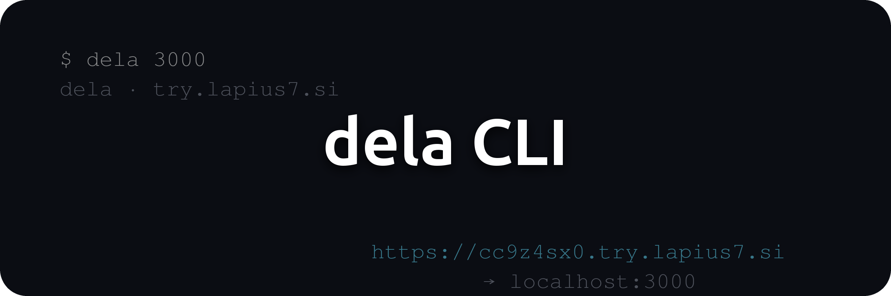

<div align="center">

<p align="center">
  
</p>

<p align="center"><b>English</b> | <a href="README.ja.md">日本語</a></p>

<h1 align="center">dela CLI</h1>

<h3 align="center">Publish a local port as a temporary HTTPS URL.</h3>

<p align="center">Run <code>dela 3000</code> and <code>localhost:3000</code> is reachable at <code>https://app-xxxxxxxxxx.try.lapius7.si</code>. No account and no SSH key are needed.</p>

<p align="center">
  <a href="https://github.com/Lapius7/dela-cli/releases"></a>
  <a href="LICENSE"></a>
  <a href="https://go.dev"></a>
  <a href="https://github.com/Lapius7/dela-cli/stargazers"></a>
  <a href="https://github.com/Lapius7/dela-cli/commits/main"></a>
</p>

<p align="center">
  <a href="#overview">Overview</a> ·
  <a href="#requirements">Requirements</a> ·
  <a href="#install">Install</a> ·
  <a href="#usage">Usage</a> ·
  <a href="#troubleshooting">Troubleshooting</a> ·
  <a href="#development">Development</a>
</p>

</div>

---

## Overview

dela is a tunnel CLI similar to `cloudflared tunnel --url`. It publishes a local port through the tunnel server at `try.lapius7.si` (sish). It is a thin wrapper that runs the system `ssh` command as a subprocess and does not reimplement the SSH protocol.

Full usage guide: <https://try.lapius7.si/use>

```
dela 3000
```

```
dela · try.lapius7.si

  ✓ Tunnel established

    https://app-k3x9q2m7ab.try.lapius7.si
        → localhost:3000

  Ctrl+C to quit · use dela list / dela stop from another terminal
```

The panel is colored. Output has no color when `NO_COLOR` is set or stdout is not a TTY. Pressing `Ctrl+C` closes the tunnel, and the URL stays invalid until the next start. The server returns a `noindex` header and `robots.txt` so search engines do not index it.

## Requirements

- `ssh` (8.4 or later) on your system. Windows 10/11, macOS, and Linux include it.
- Only HTTP(S) is supported (no TCP forwarding). The server limits concurrent connections and connection rate per IP, and closes a connection after 1 hour without traffic.
- No account and no SSH key are needed (anyone can use the public tunnel). On the first run the server issues a subdomain, and dela saves it to `.delaconfig`. dela does not use your SSH keys, `~/.ssh/config`, or ssh-agent.
- The server's host key is pinned in the binary, so there is no host-key prompt. If the key does not match, dela refuses to connect. Fingerprint:
  ```
  SHA256:TFfR22+f3m4Fpp/5u3svHfC95Srtq+OyhWqylM8ioGc
  ```
- Start the local server before running dela. dela only forwards traffic, so a port with no listener returns `502 Bad Gateway`.

## Install

### pnpm (recommended)

This package assumes pnpm. Installing with both npm and pnpm creates the same command twice, so use only `pnpm add -g`.

```bash
pnpm add -g @lapius/dela-cli
```

This installs a prebuilt binary for Linux, macOS (x64, arm64), or Windows (x64). Go is not required; Node.js 18 or later is. Run the same command to update.

### Installer scripts (build from source with Go)

For machines with Go installed.

macOS / Linux / Windows (Git Bash, WSL):

```bash
curl -fsSL https://raw.githubusercontent.com/lapius7/dela-cli/main/install.sh | bash
```

Windows (PowerShell):

```powershell
irm https://raw.githubusercontent.com/lapius7/dela-cli/main/install.ps1 | iex
```

Windows (cmd) cannot run a `irm`/`iex` one-liner, so save the file first and run it:

```bat
curl -fsSL https://raw.githubusercontent.com/lapius7/dela-cli/main/install.bat -o install.bat && install.bat
```

Each script runs `go install github.com/lapius7/dela-cli/cmd/dela@latest` with `GOPROXY=direct`. The binary goes to `$(go env GOPATH)/bin` (`%GOPATH%\bin` on Windows). If that directory is not on your PATH, the installer prints a warning. `GOPROXY=direct` is set because the official Go module proxy can cache the `@latest` result for a branch without tags, and an update would then return an old commit for a while. Run the same command again to update.

## Usage

```
dela <port>          e.g. dela 3000        (publishes localhost:3000)
dela <host:port>     e.g. dela 127.0.0.1:8080
dela <port> -v       also show the connection log
dela --help
```

### Per-project URL

The first `dela 3000` creates a `.delaconfig` file in the project folder (the git root, or the current directory if there is no repository). It holds the ID issued by the server (the `xxxxxxxxxx` part of `app-xxxxxxxxxx.try.lapius7.si`) and a token that proves ownership. The same project gets the same URL every time, and running from a subfolder uses the parent's `.delaconfig`.

```
dela 3000                 → https://app-xxxxxxxxxx.try.lapius7.si
dela 4000 --name api      → https://api-xxxxxxxxxx.try.lapius7.si   (another service in the same project)
dela 3000 --config ~/.dela/projects/app.delaconfig   (path of .delaconfig; creates it if missing. DELA_CONFIG also works)
dela info                 show this project's URL (--json adds the running services; the token is not printed)
dela renew                issue a new subdomain (ID); the old URL stops working
dela 3000 --temp          temporary mode (below)
```

**Temporary mode** `--temp` (`-t`): dela does not read or create `.delaconfig`, and publishes with a throwaway ID. The URL is discarded when dela exits, and the next run gets a different one. Use it to share a sample or to leave no config file in the project.

- `.delaconfig` contains a secret token. In a git repository dela appends it to `.gitignore`. Do not share it or commit it.
- The ID cannot be used by other people (the token authenticates it). If you delete `.delaconfig`, the next run issues a new ID, and the old ID is discarded after 90 days unused.
- Two tunnels with the same name (`app`, `api`) cannot run at the same time.
- To use the same URL on another PC, copy `.delaconfig` into that PC's project.

### Auto reconnect

If the connection drops (a network blip, the PC sleeping), dela reconnects with the same URL, retrying with intervals from 1 to 30 seconds. Quit with `Ctrl+C`. Use `--no-reconnect` to turn it off.

### Inspect requests (`--inspect` / `-i`)

```
dela 3000 --inspect
```

Each incoming request is printed on one line. Open `http://127.0.0.1:4040` (4041 and up if in use) to see headers and body (first 64 KB; JSON is formatted, gzip is decompressed). This is useful for debugging webhooks. Values of `Authorization`, `Cookie`, and `Set-Cookie` are recorded as `[redacted]`. The viewer listens only on `127.0.0.1` of this PC, and records stay in memory (latest 300, gone when dela exits). Change the port with `--inspect-port 5050`.

### Password protection (`--auth`)

```
dela 3000 --auth demo:s3cret
DELA_AUTH=demo:s3cret dela 3000      # environment variable (keeps it out of shell history)
```

The public URL asks for Basic authentication. The local `dela` checks it, so the password is not sent to the server, and a request that fails never reaches your local server. It works together with `--inspect`. The value is not saved to `.delaconfig`, so pass it on every start.

### Manage tunnels

Running tunnels leave one record per process in `~/.dela/state/`, so another terminal can list and stop them. There is no daemon: each `dela` process creates and removes its own record.

```
dela list             running tunnels (PID, URL, target, elapsed). --json prints a JSON array (pid, url, name, target, dir, temp, started_at)
dela stop <PID>       stop the tunnel with that PID
dela stop --all       stop all tunnels
dela version          show the version
```

## Troubleshooting

- **`502 Bad Gateway`**: The tunnel itself is working. Nothing is listening on the port you gave. Check that `http://localhost:<port>/` opens locally.
- **A change does not appear after `go install`**: The Go module proxy cache can be the cause. Run `go install` again with `GOPROXY=direct` (bash) or `$env:GOPROXY = "direct"` (PowerShell). The installers already do this.

## Development

The code lives in `cmd/dela/` and uses only the Go standard library, with no external dependencies.

| File | Role |
|---|---|
| `main.go` | Entry point: ssh invocation, output formatting, signal handling |
| `style.go` | ANSI coloring (`NO_COLOR` and non-TTY detection) |
| `spinner.go` | Spinner while connecting |
| `state.go` | Local state files for `dela list` / `stop` (`~/.dela/state/`) |
| `project.go` | Reading and writing `.delaconfig`, issuing and releasing IDs on the server, `dela renew` / `info`, handling the ssh password prompt (SSH_ASKPASS) |
| `proxy.go`, `inspect.html` | Local reverse proxy for `--auth` and `--inspect`, request recording, viewer page |
| `commands.go` | `list`, `stop`, `version` |
| `procalive_unix.go`, `procalive_windows.go` | Process liveness check per OS |

`server/registry.py` is a small HTTP service that issues IDs (Python standard library and SQLite). It uses sish's `--authentication-password-request-url` and `--append-user-to-subdomain`: the username is the ID, the password is the token, and the public host name becomes `<name>-<ID>.<domain>`. Tokens are stored as SHA-256.

> [!NOTE]
> Unverified: this rewrite did not run dela against the live server, and the pinned host-key fingerprint and the 90-day ID expiry are taken from the existing README and code, not retested.

## License

[MIT](LICENSE)
